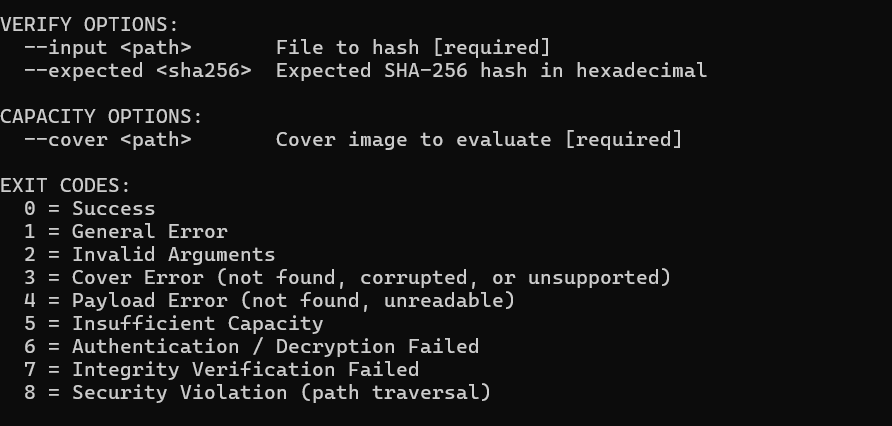
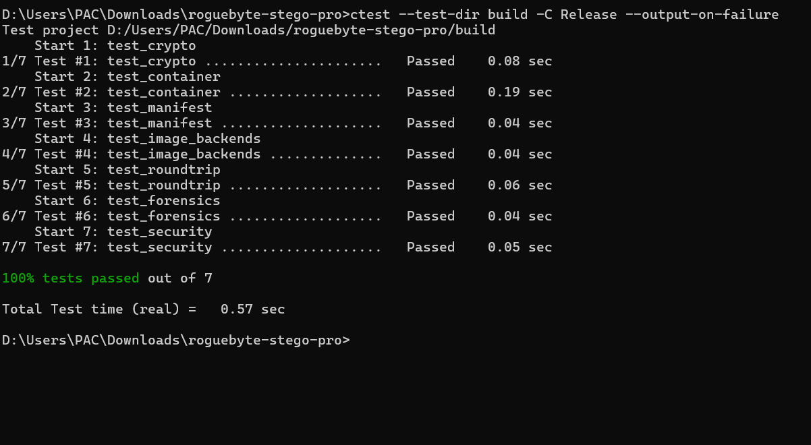

# RogueByte Stego Pro

[](https://en.cppreference.com/w/cpp/20)
[](https://cmake.org)
[](https://www.openssl.org)
[](LICENSE)
[](#supported-platforms)

**RogueByte Stego Pro** is a cross-platform steganography and digital-forensics command-line project written in modern **C++20**. Depending on the enabled build features, it can embed files in supported image carriers, protect embedded data with authenticated encryption, inspect images for structural or statistical anomalies, extract stored files, and verify file integrity.

- **Author:** SidoDev-Dz
- **Organization:** RogueByte
- **Primary language:** C++20

> **Important:** CLI examples below assume the listed commands and options are implemented in your checked-out version. Confirm with `--help` and the test suite before relying on any option. Never use sensitive real files while testing.

---

## Screenshots

Add genuine screenshots captured from your own build to the `screenshots/` directory using these filenames. GitHub will display them automatically once the files are committed.

### 1. Application overview


### 2. Image inspection and forensic output


### 3. Embedding, extraction, and verification


If the images do not appear, check that the files exist at these exact paths and are committed to the repository. These Markdown references do not create the image files for you.

---

## Key Features

### 1. Binary payload handling
- Intended for files such as ZIP archives, PDFs, text documents, source code, and other binary data, subject to the implementation and carrier capacity.
- Embedded payloads should be treated as untrusted data and must never be executed automatically.
- If supported by the build, archive metadata may preserve original filenames, sizes, timestamps, and SHA-256 hashes.

### 2. Image carrier backends
The project documentation describes support for:
- **PNG:** lossless pixel-domain embedding using least-significant-bit (LSB) techniques.
- **BMP:** lossless embedding for supported uncompressed bitmap formats.
- **JPEG:** structural marker-based storage, if implemented in the checked-out version.
- Capacity checks to reject payloads that exceed the available carrier space.

JPEG marker-based storage is not the same as embedding in JPEG image coefficients. Re-saving or optimizing an image with external software may remove embedded marker data.

### 3. Encryption and container format
The intended security features include:
- **AES-256-GCM** authenticated encryption.
- **PBKDF2-HMAC-SHA256** password-based key derivation, if enabled in the build.
- Authentication checks to detect tampering with encrypted data.
- A versioned container format and bounded parsing.

Cryptographic algorithms and parameters listed here should be verified against the actual source code and build configuration. Do not describe a feature as enabled unless it is implemented and tested.

### 4. Digital-forensics inspection
- Image structure checks.
- Bit-plane Shannon entropy analysis, if implemented.
- Pairs-of-Values chi-square analysis for potential LSB anomalies, if implemented.
- Detection of the project's own container format, if implemented.
- A distinction between a confirmed project container and heuristic statistical findings.

Statistical anomalies alone do **not** prove that an image contains hidden data.

### 5. Safer file handling
The project aims to provide safe extraction and integrity checks. Review the implementation and tests for path traversal protections, bounded input parsing, and atomic output handling before using it with untrusted files.

---

## Supported Platforms

| Platform | Toolchain | Notes |
|---|---|---|
| Linux (x86_64) | GCC / Clang, CMake | Build using the commands below |
| Kali Linux | GCC / Clang, CMake | Same Linux workflow |
| Windows 10/11 x64 | Visual Studio 2022 and CMake | Executable path depends on generator/configuration |
| Android Termux | Clang, CMake, OpenSSL | Requires compatible dependencies |

Platform compatibility depends on the current source tree and dependencies. Run the build and tests on each platform before claiming that platform is verified.

---

## Requirements

- Git
- CMake 3.20 or newer (as indicated by the project badge)
- A compatible C++20 compiler
- OpenSSL development files/libraries if required by the build
- PNG or other image dependencies required by the project

---

## Quick Start and Installation

### Linux / Kali Linux

Install common build dependencies:

```bash
sudo apt-get update
sudo apt-get install -y build-essential cmake libssl-dev git
```

Clone the repository (replace the URL if your canonical repository URL differs):

```bash
git clone https://github.com/RogueByteOfficial/roguebyte-stego-pro.git
cd roguebyte-stego-pro
```

Configure and build:

```bash
cmake -B build -DCMAKE_BUILD_TYPE=Release
cmake --build build -j"$(nproc)"
```

Run the test suite:

```bash
ctest --test-dir build --output-on-failure
```

### Windows 10/11 — Visual Studio 2022

Open **Command Prompt** or **PowerShell** in the project root. Ensure CMake and Visual Studio 2022 C++ build tools are installed.

Configure:

```bat
cmake -B build -G "Visual Studio 17 2022" -A x64
```

Build Release:

```bat
cmake --build build --config Release
```

Run tests:

```bat
ctest --test-dir build -C Release --output-on-failure
```

With the Visual Studio generator, the executable is commonly located at:

```bat
.\build\Release\rb-stego.exe
```

Some projects/configurations place it directly in `build`. If the path above does not exist, locate the generated executable in the `build` directory before running commands.

### Android Termux (no root intended)

Install dependencies:

```bash
pkg update
pkg install -y clang cmake make openssl git
```

Configure and build:

```bash
cmake -B build \
  -DCMAKE_BUILD_TYPE=Release \
  -DCMAKE_CXX_COMPILER=clang++ \
  -DCMAKE_C_COMPILER=clang
cmake --build build -j"$(nproc)"
ctest --test-dir build --output-on-failure
```

Termux compatibility depends on the libraries and compiler options used by this repository.

---

## CLI Usage and Commands

The examples below use the Linux/Kali executable path. On Windows, replace `./build/rb-stego` with the actual executable path, usually `.\build\Release\rb-stego.exe` in CMD/PowerShell.

### 1. Version and help

```bash
./build/rb-stego version
./build/rb-stego --help
```

Windows:

```bat
.\build\Release\rb-stego.exe version
.\build\Release\rb-stego.exe --help
```

### 2. Calculate cover-image capacity

Check the usable capacity of a supported cover image:

```bash
./build/rb-stego capacity --cover tests/fixtures/cover.png
```

Windows example:

```bat
.\build\Release\rb-stego.exe capacity --cover tests\fixtures\cover.png
```

### 3. Embed files in an image

This example embeds two test payloads into a PNG and requests encryption:

```bash
./build/rb-stego embed \
  --cover tests/fixtures/cover.png \
  --input tests/fixtures/payload_archive.zip \
  --input tests/fixtures/payload_doc.pdf \
  --output result_stego.png \
  --encrypt
```

If your version supports a `--password` option, you can use the interactive prompt (recommended so the password is not stored in shell history). If your version requires an explicit password option, consult `./build/rb-stego embed --help` and follow the exact syntax reported by the program.

Example using an explicit password **only if the option is supported**:

```bash
./build/rb-stego embed \
  --cover tests/fixtures/cover.png \
  --input tests/fixtures/payload_archive.zip \
  --output result_stego.png \
  --encrypt \
  --password "ReplaceWithATestPassword" \
  --force
```

Use test data and a unique test password. Avoid placing real passwords in scripts, screenshots, or shell history.

### 4. Inspect an image

Human-readable output:

```bash
./build/rb-stego inspect --input result_stego.png
```

JSON output for automation:

```bash
./build/rb-stego inspect --input result_stego.png --json
```

### 5. Extract embedded files

```bash
./build/rb-stego extract \
  --input result_stego.png \
  --output-dir ./extracted_files/
```

If encryption is enabled, supply the password using the exact supported syntax. For example, use `--password` only if shown by the program's help:

```bash
./build/rb-stego extract \
  --input result_stego.png \
  --output-dir ./extracted_files/ \
  --password "ReplaceWithATestPassword" \
  --force
```

Review extracted files before opening them. Treat them as untrusted input.

### 6. Verify file integrity

Verify the SHA-256 integrity of a recovered file:

```bash
./build/rb-stego verify --input ./extracted_files/payload_archive.zip
```

If supported, compare against a known SHA-256 digest:

```bash
./build/rb-stego verify \
  --input ./extracted_files/payload_archive.zip \
  --expected YOUR_EXPECTED_SHA256
```

### 7. Run the automated test suite

```bash
ctest --test-dir build --output-on-failure
```

For a Visual Studio Release build on Windows:

```bat
ctest --test-dir build -C Release --output-on-failure
```

### Command summary

| Command | Purpose |
|---|---|
| `rb-stego version` | Display version information |
| `rb-stego --help` | Display general usage |
| `rb-stego capacity --cover <path>` | Calculate usable cover capacity |
| `rb-stego embed --cover <path> --input <path> --output <path>` | Embed payload(s), subject to supported options |
| `rb-stego inspect --input <path>` | Inspect an image |
| `rb-stego inspect --input <path> --json` | Return inspection output as JSON, if supported |
| `rb-stego extract --input <path> --output-dir <dir>` | Extract files |
| `rb-stego verify --input <path>` | Verify file integrity |

**Always treat `rb-stego --help` as the source of truth** for the commands and options implemented by your current binary.

---

## Repository Structure

The following is a suggested structure based on the project layout. Adjust it to match the actual repository contents.

```text
.
├── CMakeLists.txt
├── CMakePresets.json
├── include/
│   └── roguebyte_stego/
├── src/
│   ├── core/
│   ├── crypto/
│   ├── container/
│   ├── image/
│   └── cli/
├── tests/
│   ├── unit/
│   ├── integration/
│   └── fixtures/
├── docs/
│   ├── en/
│   └── ar/
├── scripts/
├── screenshots/
│   ├── screenshot1.png
│   ├── screenshot2.png
│   └── screenshot3.png
├── LICENSE
├── README.md
├── README.ar.md
├── SECURITY.md
└── CONTRIBUTING.md
```

---

## Security Notes

- Only analyze files you own or have explicit permission to examine.
- Do not execute embedded or extracted payloads.
- Use a dedicated test directory and non-sensitive test files.
- Do not treat statistical anomalies as proof of steganography.
- Avoid putting passwords directly in command history or committed scripts.
- Keep OpenSSL and other dependencies updated.
- Report suspected vulnerabilities responsibly using the repository's security policy, if available.

---

## License and Credits

- **Author:** SidoDev-Dz
- **Organization:** RogueByte
- **License:** MIT — see [`LICENSE`](LICENSE).

For bugs and feature requests, open an issue in the project's GitHub repository.
